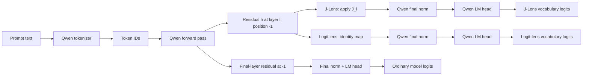
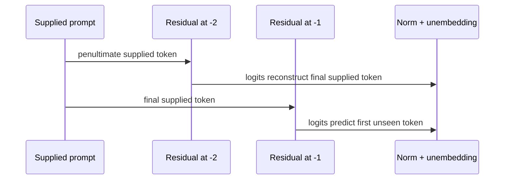
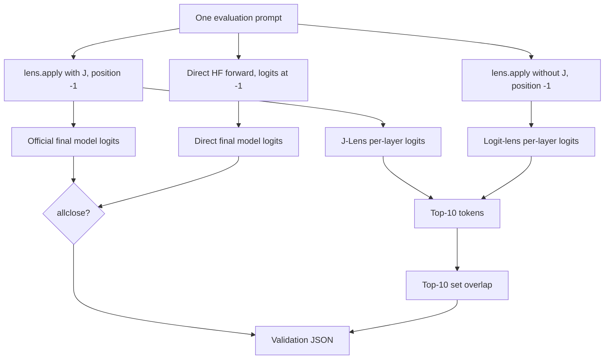

# Understanding the Official J-Lens × Qwen Experiment

> **Document version:** 1.0
> **Experiment version:** 0.3.2
> **Scope:** applying and validating Anthropic's published Jacobian lens; no lens fitting
> or from-scratch Jacobian implementation is performed in this repository.

## 1. Purpose and research boundary

This project is a controlled first step: prove that the official `jlens` package, a
matched Qwen model, and Anthropic's published lens artifact work together correctly
before reproducing the algorithm independently. It answers:

1. Can the official adapter reproduce Qwen's ordinary final readout?
2. At the same internal residual, how does J-Lens differ from a logit lens?
3. Can we render the position × layer evidence in the interactive visual language used
   by the reference project?
4. Are we reading the position that predicts the *first unseen completion token* rather
   than reconstructing a token already supplied in the prompt?

It does **not** establish that a decoded token is causally necessary or sufficient for a
model behavior. It does not fit new Jacobians, benchmark corpus-size convergence, or
claim that five hand-written prompts measure general performance.

## 2. Pinned components and why they are paired

| Component | Pinned value | Reason |
|---|---|---|
| Reference code | `anthropics/jacobian-lens@581d398613e5602a5af361e1c34d3a92ea82ba8e` | Avoid behavior changing underneath the experiment. |
| Model | `Qwen/Qwen3.5-4B` | Architecture named by the published lens fit metadata. |
| Model revision | `851bf6e806efd8d0a36b00ddf55e13ccb7b8cd0a` | Immutable model and tokenizer snapshot; prevents default-branch drift. |
| Lens repository | `neuronpedia/jacobian-lens` | Public host used by the official walkthrough. |
| Lens source ref | `qwen-n1000` | Human-readable provenance; never used as the download revision. |
| Lens revision | `16a01f309fcec900fdcec3f4cd5b64f3d00e4d5a` | Immutable lens repository snapshot containing the published artifact. |
| Lens file | `qwen3.5-4b/jlens/Salesforce-wikitext/Qwen3.5-4B_jacobian_lens_n1000.pt` | Matched width, depth, weights, and layer indexing. |
| Runtime dtype | `torch.bfloat16` for the model | Practical GPU inference dtype; lens readouts are promoted to float for comparisons. |
| Readout position | `-1` | Final supplied token; its causal logits predict the first unseen token. |

The published fit configuration names the model but does not record its Hugging Face
revision. The fit was generated on 2026-06-13; the pinned Qwen revision was the repository
HEAD from 2026-03-02 and predates that fit. Pinning it is therefore a provenance inference
from the available primary metadata, not a claim that the lens file cryptographically
attests the model SHA. Future artifacts should record this SHA at fit time.

A Jacobian matrix is architecture- and checkpoint-specific. A lens from another Qwen
size cannot be substituted: even if a matrix could be loaded, its dimensions, layers,
and learned coordinate transform would not describe this model.

## 3. Conceptual model

Let `h[l,p]` be the post-block residual stream at layer `l` and prompt position `p`, `J[l]`
the fitted mean Jacobian transport, `N` Qwen's final norm, and `W_U` its unembedding.
The experiment compares:

```text
J-Lens(l,p)     = W_U · N(J[l] · h[l,p])
LogitLens(l,p)  = W_U · N(       h[l,p])
Model(p)        = W_U · N(h[final,p])
```

The J-Lens and logit-lens branches use the same prompt, position, activation, final norm,
and unembedding. The only intended difference is the `J[l]` transport.



## 4. Causal indexing: why `-1` is essential

For input token IDs `[t0, t1, ..., tn]`, causal-LM logits at position `i` predict the next
token `t(i+1)`. At the end of a prompt:

```text
Prompt tokens:       t0   t1   ...   t(n-1)   tn
Logit position:       0    1   ...    -2      -1
Predicts:            t1   t2   ...     tn    <unseen completion>
                                      ^       ^
                                      |       correct experiment target
                                      wrong: supplied prompt token
```

Therefore, `-2` can yield perfect agreement between J-Lens API output and a direct model
call while asking the wrong question. That agreement only proves that both paths read the
same residual. Version 0.2.0 centralizes `READOUT_POSITION = -1`, applies it to all three
branches, records it in JSON, prints its meaning, and adds negative regression assertions
against literal `-2` reads.



## 5. End-to-end notebook breakdown

### Cell group 1 — environment

The notebook installs the reference project directly from the pinned Git commit, imports
PyTorch, Transformers, and `jlens`, asserts CUDA availability, reports the GPU, creates
`artifacts/`, and enables official library logging. Failing early on a CPU runtime avoids
a slow or misleading partial run.

### Cell group 2 — matched model and lens

The notebook loads Qwen in bfloat16 on CUDA and loads its tokenizer with the same immutable
Hugging Face revision. It asserts the resolved model configuration commit equals
`MODEL_REVISION`, prints that value, and later records it in the JSON report. It then wraps the Hugging
Face model using `jlens.from_hf`, then downloads the published lens using
`JacobianLens.from_pretrained` at the immutable `LENS_REVISION` commit. `LENS_SOURCE_REF`
retains the human-readable `qwen-n1000` branch name only as report provenance; it is not
passed to the downloader. The wrapper locates the transformer blocks, final norm, and LM
head needed for official activation capture and readout.

### Cell group 3 — prompt-family evaluation

Five prompt families provide a small qualitative smoke test:

| Family | Intended diagnostic | Important limitation |
|---|---|---|
| Multihop | Latent association before a factual completion | One item is not factual-accuracy evaluation. |
| Multilingual | Language/translation-related intermediate readout | Tokenization differs across languages. |
| Typo | Recovery of a corrupted entity name | Could reflect memorized surface association. |
| Ordering | Simple operation-related readout | Does not measure algorithmic generalization. |
| ASCII face | Concept readable from a non-word symbol | Designed qualitative demonstration. |

For each prompt the code:

1. Calls `lens.apply(..., positions=[READOUT_POSITION])` with Jacobian transport.
2. Calls the same method with `use_jacobian=False` for the logit-lens control.
3. Performs a direct Hugging Face forward pass.
4. Selects direct logits at the same `READOUT_POSITION`.
5. checks `torch.allclose` between the official API's final logits and direct logits.
6. extracts decoded top-10 lists for each chosen layer.
7. computes J-Lens/logit-lens top-10 set overlap.
8. writes structured results to `artifacts/qwen_validation.json`.

Selected layers are approximately 25%, 50%, 75%, and the penultimate block. This offers a
compact depth profile but is not a substitute for inspecting every fitted layer.



### Cell group 4 — interactive slice

`compute_slice` obtains readouts across prompt positions and fitted layers. `build_page`
turns the resulting arrays into Anthropic's interactive HTML, and `notebook_iframe`
renders it inside Colab. The same page is saved as a standalone HTML artifact.

The grid should be read as follows:

- **Column:** a prompt token position.
- **Row:** a transformer layer; the final row is the model's actual output readout.
- **Cell label:** a high-ranked decoded token at that position and layer.
- **Pinned token:** a token selected for rank tracking through position and depth.
- **Rank:** full-vocabulary order, where rank zero is highest.

`mask_display=True` restricts displayed winners to word-like tokens for readability; it
does not change the underlying full-vocabulary rank calculation. A beautiful grid is not
a success criterion on its own: it must be interpreted beside position semantics,
baseline differences, and the parity gate.

## 6. Generated artifacts and schema

### `artifacts/qwen_validation.json`

Conceptual schema:

```json
{
  "model": "Qwen/Qwen3.5-4B",
  "model_revision": "851bf6e806efd8d0a36b00ddf55e13ccb7b8cd0a",
  "lens_revision": "16a01f309fcec900fdcec3f4cd5b64f3d00e4d5a",
  "lens_source_ref": "qwen-n1000",
  "readout_position": -1,
  "readout_semantics": "logits after the final supplied token predict the first unseen token",
  "prompts": {
    "multihop": {
      "model_parity_max_abs_error": 0.0,
      "model_top10": ["..."],
      "layers": {
        "<layer>": {
          "jlens_top10": ["..."],
          "logit_lens_top10": ["..."],
          "top10_overlap": 0.0
        }
      }
    }
  }
}
```

The shown numeric values are placeholders illustrating shape, not experimental results.
The overlap is `|top10(J) ∩ top10(logit)| / 10`; lower overlap means different rankings,
not automatically a better or more interpretable J-Lens.

### `artifacts/qwen_ascii_face_slice.html`

A self-contained interactive view suitable for download from Colab. Treat it as an
experiment output, so `artifacts/` is gitignored rather than committed.

## 7. Validation gates and what each proves

| Gate | Mechanism | Proves | Does not prove |
|---|---|---|---|
| Dependency | immutable code and lens-repository commits | known library and artifact snapshots | semantic correctness of the artifact |
| Pairing | fixed model/lens identifiers and immutable model/tokenizer SHA | reproducible intended pairing without default-branch drift | cryptographic proof of the fitter's model SHA |
| CUDA | runtime assertion | suitable execution device exists | enough VRAM |
| Position | shared `READOUT_POSITION=-1` plus tests | next unseen token is targeted | correct prompt design |
| Parity | `torch.allclose` API vs HF logits | adapter final readout agrees | J-Lens is meaningful |
| Control | `use_jacobian=False` | matched logit-lens baseline | causal superiority |
| Diversity | five prompt families | several phenomena are exercised | statistical generalization |
| Rank | top-10 overlap and slice ranks | ranking differences are measurable | higher behavioral accuracy |
| Structural tests | notebook-source assertions | critical experiment contract remains present | numerical execution succeeds |

The parity tolerance (`atol=0.25`, `rtol=0.01`) accommodates bfloat16 and adapter path
numerics. The maximum absolute error is retained for auditing; a future GPU run should
inspect its distribution rather than treating a single threshold as universally optimal.

## 8. How to run and inspect

1. Open `notebooks/qwen_official_jlens.ipynb` in Google Colab.
2. Select an L4 or A100 GPU runtime.
3. Run cells from top to bottom without skipping installation or assertions.
4. Confirm the printed GPU, full model and lens revision SHAs, model wrapper, and lens metadata are expected.
5. For every prompt, confirm the printed readout token is labeled as predicting the next
   unseen token.
6. Confirm no parity assertion fails.
7. Compare J-Lens and logit-lens top tokens by layer; avoid judging only one layer.
8. Interact with the ASCII-face slice and pin meaningful candidate tokens.
9. Download both files in `artifacts/` before the Colab runtime is deleted.
10. Record GPU type, package versions, and unexpected warnings with the artifacts.

## 9. Reading results responsibly

A useful result is a repeatable difference between J-Lens and the matched logit-lens
control whose token ranks align with a defensible semantic hypothesis. It is stronger if
seen across prompts and layers rather than in a single top-1 cell.

Do not infer:

- that the model “thinks in words” solely because a word is decodable;
- that a representation causes the eventual answer without an intervention;
- that low top-k overlap means higher quality;
- that copying a prompt token is a latent concept;
- that parity validates prompt position (the original `-2` bug demonstrates otherwise);
- that these five prompts estimate population-level performance.

## 10. Failure modes and troubleshooting

| Symptom | Likely cause | Action |
|---|---|---|
| CUDA assertion fails | CPU Colab runtime | Change runtime type to GPU and restart. |
| Out of memory | GPU too small or stale allocations | Restart runtime; prefer L4/A100; avoid duplicate model instances. |
| Lens download fails | Hub connectivity/revision issue | Check network and the exact repo, revision, and filename. |
| Shape/layer error | Model and lens mismatch | Do not substitute another Qwen checkpoint. |
| Parity assertion fails | position, dtype, adapter, or version mismatch | Inspect max error; verify pinned dependency and `-1` on both branches. |
| Odd decoded fragments | subword tokenizer behavior | Inspect token IDs and ranks; do not concatenate interpretations casually. |
| Blank visualization | iframe/browser restriction or interrupted build | save/open the HTML artifact and rerun the visualization cell. |
| Results seem to echo prompt ending | wrong position or copying | confirm `READOUT_POSITION=-1` and inspect input-token ranks. |

## 11. Repository map

```text
.
├── README.md                         quick start and experiment contract
├── understanding.md                  detailed conceptual/code walkthrough
├── changes_log.md                    versioned history and fixes
├── notebooks/
│   └── qwen_official_jlens.ipynb     executable Colab GPU experiment
├── tests/
│   └── test_notebook.py              structural regression contract
└── .gitignore                        excludes generated artifacts/caches
```

## 12. Next steps after official-library validation

```mermaid
flowchart LR
    A[Run official published lens] --> B[Archive numerical + HTML artifacts]
    B --> C[Expand disjoint evaluation prompts]
    C --> D[Add quantitative rank metrics]
    D --> E[Reproduce one official prompt/layer numerically]
    E --> F[Only then implement fitting from scratch]
    F --> G[Finite-difference and batching parity tests]
    G --> H[Corpus-size and intervention studies]
```



Recommended improvements are: a machine-readable environment manifest, multiple prompt
instances per family, explicit calibration/evaluation separation metadata, token-level
copying diagnostics, rank-of-target curves, and a GPU CI smoke test if model access and
cost allow it. From-scratch work should begin only after this reference run is archived
and understood.
